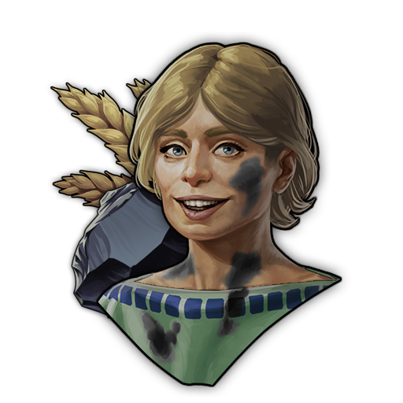
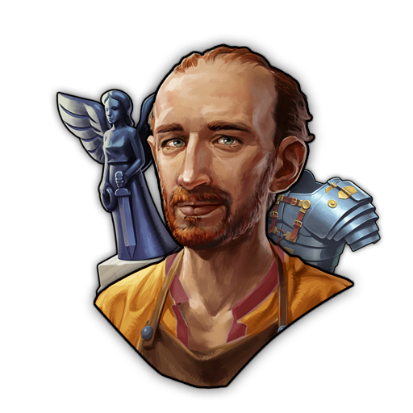
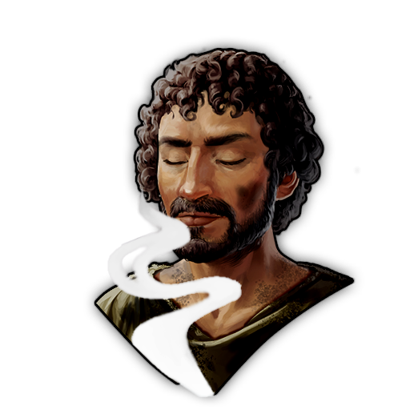
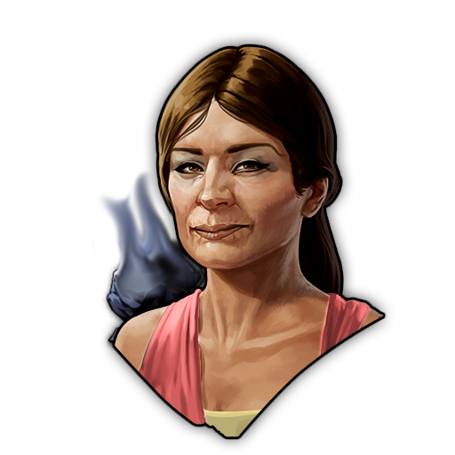
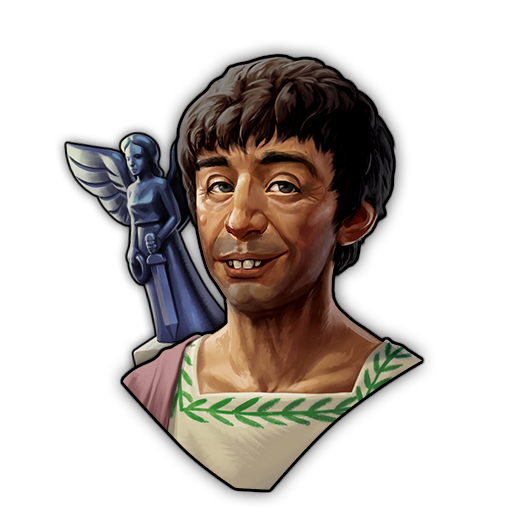
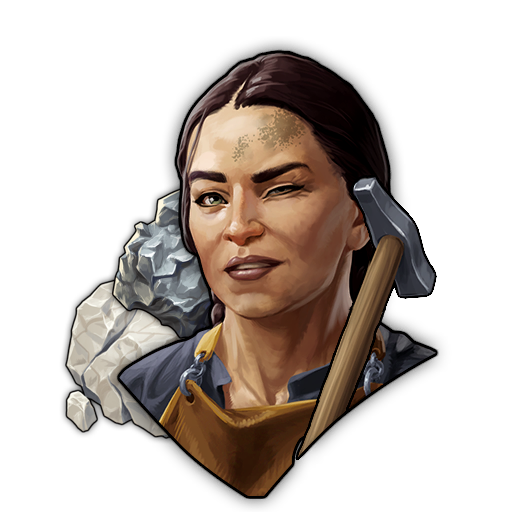
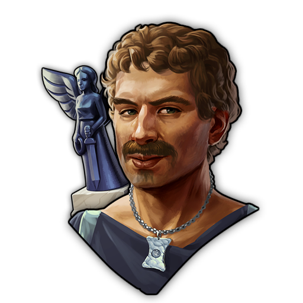
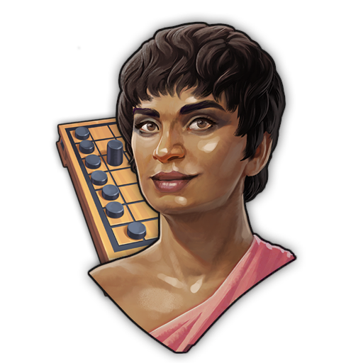
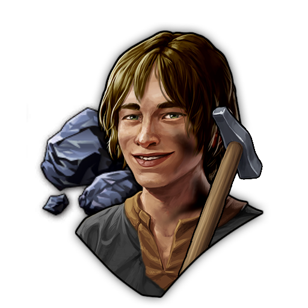
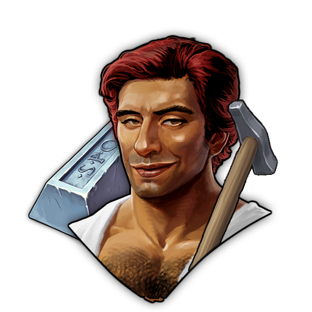

# DLC-01 Specialist Pack
This mod adds Specialists focused on Content added by the DLC-01 "Prophecy of Ashes" into Anno 117. This Mod is part as a submod of "Extended Specialists Mod".
***

### Common Specialists
| Image Preview | GUID | Internal Name | Itemname | Description | Targets | Base Effects |
| :---: | :---: | :---: | :---: | :---: | :---: | :---: |
|  | 1600000886 | Specialist AddObsi-Landside-C | Ash-Covered Farmer | Even a ash-covered Farm sometimes yields a grain of corn. Or Obsidian. &#xD;(DLC1-Pack) | Farms, Plantations, Pastures | **Building Buff:** • Additional **Obsidian** by 1 unit every 40 cycles.  • Contains an option in modinfo.json to ignore Obsitian Deposit. |
|  | 1600000839 | Specialist AE-ReInput-Figur-ArmorRObsi-C | Armored Figure Artist | His muse is the worn armor of various legionnaires. &#xD;(DLC1-Pack) | Caeleator |  • Replaces Input of Obsidian with Armor. **Area Effect:** -3 Prestige. |
|  | 1600000845 | Specialist AE-ReInput-Boards-WeaponRObsi-C | Latrunculi-Stone Sharpener | Beware. His game pieces can actually kill. &#xD;(DLC1-Pack) | Latrunculi Workshop | **Building Buff:** • Replaces Input of Obsidian with Weapons. **Area Effect:** -2 Health |

***

### Rare Specialists

| Image Preview | GUID | Internal Name | Itemname | Description | Targets | Base Effects |
| :---: | :---: | :---: | :---: | :---: | :---: | :---: |
|  | 1600000849 | Specialist AE-MinorVulcanShrine-R | Worshipper of Vulcan | "Oh please Vulcan! Show me your power and cover me with your dark blanket!" &#xD;(DLC1-Pack) | Vulcan Shrine | **Area Effect:** • Increases Fire Safety by 1.6. |
|  | 1600000866 | Specialist AE-FuelC-Belief-R | Vulcan's Igniter | "Let's keep these ovens burning! ... Well now the house is the oven... A respectable offer for Vulcan!" &#xD;(DLC1-Pack) | All Fuel-Consumer | **Area Effect:** -1 Fire Safety and +3 Belief. |
|  | 1600000874 | Specialist AE-Figures-R | Mindful Obsidian Caelator | "Watch out! Obsidian is very sharp. Keep it slow and your body will thank you." &#xD;(DLC1-Pack) | Caeleator | **Building Buff:** • Decrease productivity by 15%. **Area Effect:**  +1 Health and +2 Happiness. |
|  | 1600000878 | Specialist AE-Boards-R | Latrunculi Tournament Organizer | "With a good Latrunculi Tournament, we can find good strategic minds. &#xD;(DLC1-Pack)" | Latrunculi Workshop | **Building Buff:** • Decrease productivity by 15%. **Area Effect:** Grants +1.5 Knowledge and +1.5 Happiness. |

***
### Epic Specialists
| Image Preview | GUID | Internal Name | Itemname | Description | Targets | Base Effects |
| :---: | :---: | :---: | :---: | :---: | :---: | :---: 
|  | 1600000862 | Specialist Upkeep-FuelConsumer-E | Fornaxius Semperardens, The Ever-Warm One | With him, you won't have to worry about your ovens anymore. &#xD;(DLC1-Pack) | All Fuel-Consumer | **Building Buff:** • Decrease Maintenance by 80% and Workforce by 40%. 
|  | 1600000860 | Specialist Prod-Vulcan-E | Gaius Metallicus Vulcanius, Vulcan Blessed Miner | Leaves no stone unturned. &#xD;(DLC1-Pack) | All Vulcan Blessed Chains | **Building Buff:** • +35% Productivity. 
|  | 1600000882 | Specialist AE-TempleVulcan-E | Priestess of Vulcan | Even when Vulcan is angry, she remains true to her beliefs. &#xD;(DLC1-Pack) | Temple |  **Area Effect Bonus:** +1.6 Fire Safety. 
|  | 1600000837 | Specialist NR-Figures-E | Marcus Obsidius Sacratus, Collector of Holy Figures | "Don't touch! Only Look!" &#xD;(DLC1-Pack) | All Residences | **Building Buff:** • +20% Consumption of Figures  • +2 Money, • +3 Belief,  •+2 Happiness  • from Figures. 
|  | 1600000843 | Specialist NR-Boards-E | Latronia, Latrunculi Teacher | "Not many people know the rules of Latrunculi. Let me help you with that." &#xD;(DLC1-Pack) | All Residences | **Building Buff:** • +20% Consumption of Latrunculi  • +2 Money, • +3 Knowledge, • +2 Happiness  • from Latrunculi. 

### Legendary Specialists
| Image Preview | GUID | Internal Name | Itemname | Description | Targets | Base Effects | Boosted Effects | Boost Condition |
| :---: | :---: | :---: | :---: | :---: | :---: | :---: | :---: | :---: |
|  | 1600000864 | Specialist Prod-CoalMine-L | Overzealous Singing Coal Miner | "Coal, Coal, Coal, ... Coal, Coal - Coal, Coal, lalala, Coal, Coal, tralala, ..." &#xD;(DLC1-Pack) | All Coal Mines | **Building Buff:** • +75% productivity | **Building Buff:** • +100% productivity. • Decrease Maintenance and Workforce Maintenance by 100%. | Own 8 Warehouses on Island |
|  | 1600000853 | Specialist AE-MajorVulcanShrine-L | Vulcan's Wandering Priestess | She survived the fury of Vulcan multiple times. Now, she reminds people to never underestimate him. &#xD;(DLC1-Pack) | All Vulcan-Shrines | **Building Buff:** • Decrease Maintenance by 50%. **Area Effect:** +1.5 FireSafety. | **Building Buff:** • Decrease Maintenance by 100%. • **Area Effect:** +2 FireSafety. | Own 5 Shrines of Vulcan |
|  | 1600000871 | Specialist ReInput-BoFig-IronRObsi-L | Valerius Flamma, Holy Smith of Vulcan | Keeper of the hidden formula to make Obsidian obsolete. &#xD;(DLC1-Pack) | Caelator, Latrunci Workshop | **Building Buff:** • +15% Productivity. • Replaces Input of Obsidian with Iron.  | **Building Buff:** • +15% Productivity.. • Replaces Input of Obsidian with Iron. • Additional Output based on Production by 1 unit every 4 cycles. | Own 8 Ironsmelters |